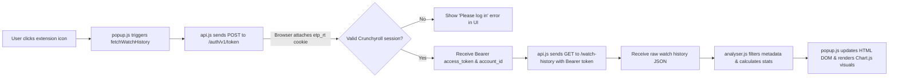

# Crunchyroll Browser Extension

This repository contains a browser extension for Firefox and Google Chrome which provides information about streaming patterns on Crunchyroll.

**This is an unofficial, fan made project and has no affiliation with Crunchyroll.**

## Aims of this repository

This project has two key aims:
- Improving JavaScript skills
- Improving understanding of web based services and applications

## Languages and key information

Languages: **HTML**, **CSS**, **JavaScript**  
Development environment: **VSCode**  
Key libraries: **Chart.js**  

## Security Notice

This extension uses your active browser session to authenticate requests to Crunchyroll's internal API. While installed and active, it effectively shares the same account access as a signed-in browser session on Crunchyroll. 

- **Local Processing Only:** All data fetching and analysis happen entirely locally within your browser. 
- **No Data Collection:** Your session cookies, access tokens, and watch history are never stored permanently or transmitted to any external servers.


## System Architecture

This extension uses a **stateless, client-side pipeline**. No data is saved between sessions, and all processing happens locally in the browser:

1. **Authenticated Fetch:** Uses the browser's active Crunchyroll session to request raw watch history JSON from Crunchyroll's internal API.
2. **Data Cleaning:** Filters out unnecessary metadata and calculates metrics like total watch time and episode counts.
3. **UI Rendering:** Updates the popup HTML and generates visual charts using Chart.js.

As Crunchyroll does not have a public API, the system will work by having the user sign in to their account on a browser, giving that browser session access to Crunchyroll's internal API via the users active account. Allowing the data to be accessed.




## Functionality

The extension should present the following analyses of the streaming history:
- Total number of hours watched
- Most watched genre
- Sub vs dub percentage (Pie chart)
- Total number of episodes watched
- Top 5 most watched shows by time watched (Graph)
- Last watched episode
- Number of unique shows watched

It should have the following filters:
- Date
- Day of week
- Genre


## Repository Structure

```text
|-- manifest.json       # Extension manifest (Manifest V3)
|-- assets/icons/       # Extension toolbar and icons
|-- lib/                # Third-party libraries (Chart.js)
|-- src/
    |-- popup/          # Extension popup UI (HTML, CSS, DOM logic)
    |-- utils/          # API fetching and data-cleaning modules
```


## Known limitations

- Browser extension requires user to log in to their Crunchyroll account on that browser so there is an active session cookie before any of the data can be accessed
- No compatibility with Google Chrome on Android due to extensions not being supported
- No compatibility with IOS due to operating system and app store policy restrictions


